# Taller Nexo · Vue 3 + TypeScript con arquitectura hexagonal

Respuestas, prácticas y evidencias de las 14 guías del instructor John Carlos Arrieta Arrieta.

- **Estudiante:** _(completar)_
- **Proyecto de referencia:** [arrietajohn/user-crud-vuejs-app](https://github.com/arrietajohn/user-crud-vuejs-app) (licencia MIT)
- **Este repositorio:** reconstrucción desde una carpeta vacía siguiendo el **Camino B** de la guía 01, con **un commit por guía**. La rama `ejercicios` contiene las prácticas que las guías piden hacer "en una copia o rama propia".

## Resumen de resultados

| Comprobación | Comando | Resultado en `main` | Resultado en `ejercicios` |
| --- | --- | --- | --- |
| Tipos | `npx vue-tsc --noEmit` | Sin errores | Sin errores |
| Pruebas unitarias | `npm test` | 8 de 8 correctas | 8 de 8 correctas |
| Build de producción | `npm run build` | Correcto (`dist/`, JS 134 kB, CSS 20 kB) | Correcto |
| Pruebas de navegador | `npm run test:e2e` | 4 de 4 correctas | 4 de 4 correctas |
| Recorrido manual en Chrome | Simulación Postman + Vite | Login, guard, CRUD, roles, registro, 403 y 401 verificados | Ejercicios verificados |

**Entorno usado:** Windows 11, Node 22.18.0, npm 10.5.1 (las dependencias de desarrollo se instalaron con npm 11.21.3 mediante `npx`, ver [problemas](#problemas-reales-encontrados-y-cómo-se-resolvieron)), Postman CLI 1.94.0, Playwright 1.64.1 con su Chromium, Google Chrome para el recorrido manual.

La guía recomienda Node 26; usé Node 22.18 porque ya estaba instalado y la propia guía indica que Vite acepta Node 22.12 o superior y Vitest 5 acepta Node 22.12, 24 o 26. Todas las comprobaciones pasaron con esa versión.

**Sobre la cuenta:** no tengo una cuenta ACTIVE del backend real, así que todo el recorrido se hizo contra la **simulación local de Postman** (guía 12, sección 8) con `admin@example.com / password123`, que solo existen en el mock. La API remota de Render respondió `401` a un login con datos falsos, lo que demuestra que estaba en línea, pero no se probó con una cuenta real.

---

## Guía 01 · De un equipo sin preparar a una aplicación arrancada

**Qué hice** (commit `42643b9`): carpeta vacía, `npm init -y`, y las instalaciones exactas de la guía:

```bash
npm install vue@3.5.44 vue-router@4.6.4 lucide-vue-next@0.468.0
npm install -D typescript@5.9.3 vite@7.3.7 @vitejs/plugin-vue@6 vue-tsc@3 @types/node@24 vitest@5.1.0 @playwright/test@1.64.1
```

Después reemplacé el manifiesto inicial por el del proyecto (`private`, `type: module` y los cinco scripts), y agregué `.gitignore`, `.env.example` y la licencia. También ejecuté el **Camino A** sobre el repositorio original (`npm ci`, `npm run dev`) para comparar.

**¿Qué corre en Node y qué corre en el navegador?**
En Node corren las herramientas: npm, el servidor de desarrollo de Vite (incluido el proxy de `/api`), `vue-tsc`, Vitest, el ejecutor de Playwright y la compilación. En el navegador corre la aplicación ya transformada: `main.ts`, Vue, el router, las vistas, `fetch` y `localStorage`. El Node de mi equipo no es el servidor Java de los usuarios.

**¿Por qué npm tiene que ejecutarse dentro de la carpeta correcta?**
npm busca `package.json` en la carpeta actual. De ahí lee los scripts y ahí crea `node_modules` y el bloqueo. En otra carpeta falla con "no encuentra el manifiesto" o instala las dependencias donde no corresponde.

**¿Por qué la pantalla de login abre aunque el backend esté apagado?**
Porque Vite entrega el HTML, el CSS y el JavaScript; eso basta para dibujar el formulario. El backend solo se usa cuando el formulario hace la petición `POST /api/auth/login`. Que se vea el login prueba que arrancó el frontend; para probar la API hace falta una petición exitosa.

---

## Guía 02 · Leer TypeScript y Vue sin perderse

Conceptos que aparecen en el código de Nexo:

| Concepto | Dónde se ve | Qué significa |
| --- | --- | --- |
| `interface` | `LoginCommand`, `UserGateway` | Forma o contrato de un objeto, sin lógica |
| Unión con `null` | `Session \| null` en `SessionStore.get()` | Puede haber sesión o su ausencia explícita |
| `unknown` | `errorMessage(e: unknown)` en `context.ts` | No sé qué es; hay que comprobarlo (`instanceof Error`) antes de usarlo |
| Genéricos | `request<T>()`, `Promise<User>` | El que llama dice qué tipo espera recibir |
| `Omit` y `?` | `UpdateUserCommand extends Omit<CreateUserCommand, 'password'>` con `password?: string` | Reutiliza campos, quita uno y lo vuelve opcional |
| `?.` y `??` / `\|\|` | `session?.token`, `defaults[status] \|\| ...` | Acceso seguro y valor por defecto; `??` solo reemplaza `null`/`undefined`, `\|\|` también `''` y `0` |
| `as const` | `USER_ROLES = [...] as const` | Convierte la lista en tipos literales: `UserRole = 'ADMIN' \| 'MEMBER' \| 'REVIEWER'` |
| `async`/`await` | Servicios, adaptador, vistas | La petición llega después; `await` espera sin congelar la interfaz |
| `<script setup lang="ts">` | Todas las vistas | Lo declarado en el bloque se usa directo en la plantilla |
| `ref` y `computed` | `const busy = ref(false)`, `filtered = computed(...)` | Estado reactivo (`.value` en el script) y valores derivados que se recalculan solos |
| Directivas | `v-model`, `v-if`, `v-for` con `:key`, `@submit.prevent`, `:disabled` | Enlace bidireccional, condicionales, listas, eventos y atributos con expresiones |

`ref` no es `localStorage`: el primero participa en la reactividad de Vue; el segundo es almacenamiento del navegador y no se vuelve reactivo solo.

**Práctica corta** (rama `ejercicios`, commit "práctica de ref, computed y v-if"): `src/entrypoint/gui/practicas/SaludoPractica.vue`, en la ruta pública `/practica/guia-02`. El input usa `v-model`, un botón cambia el nombre a "María", un `computed` lo muestra en mayúsculas y un `v-if` avisa cuando tiene menos de 3 caracteres.

| Nombre corto: aparece el aviso del `v-if` | Botón: cambia el input y el `computed` |
| --- | --- |
|  |  |

---

## Guía 03 · Qué dice cada archivo de configuración

**Qué hice** (commit `a042762`): `tsconfig.json`, `vite.config.ts` e `index.html`. `vitest.config.ts` y `playwright.config.ts` llegaron con la guía 12.

- **`package.json`:** `private: true` evita publicarlo en npm por accidente; `type: "module"` hace que Node trate los `.js` como módulos ES; `dependencies` es lo que llega al navegador (Vue, Vue Router, iconos); `devDependencies` son herramientas que solo corren en Node. No hay Axios (basta `fetch`), ni Pinia, ni contenedor de inyección externo.
- **`tsconfig.json`:** `strict` activa todas las comprobaciones; `moduleResolution: "Bundler"` resuelve imports como Vite; `noEmit` porque TypeScript solo revisa y Vite transforma; `lib` con `DOM` permite usar `window`, `fetch` y `localStorage`; `types: ["vite/client", "node"]` da tipos a `import.meta.env` y a los archivos de configuración; `include` cubre `src`, `tests` y los `*.ts` de la raíz.
- **`vite.config.ts`:** carga el plugin de Vue y, con `loadEnv`, lee `API_PROXY_TARGET`. Toda petición a `/api` se reenvía a ese destino (por defecto `http://localhost:8080`) con `changeOrigin`, lo que evita CORS en desarrollo.
- **`index.html`:** el `<div id="app">` donde se monta Vue y el `<script type="module" src="/src/main.ts">` que arranca todo.
- **Variables de entorno:** `VITE_API_BASE_URL` llega al navegador y se incrusta al compilar; `API_PROXY_TARGET` solo la usa Vite en Node. Nunca se ponen secretos en una variable `VITE_*`. Si el destino termina en `/api` y la base también es `/api`, se duplica `/api/api`.
- **`.gitignore`:** seis reglas: `node_modules/`, `dist/`, `.env`, `test-results/`, `playwright-report/` y `*.log`.

---

## Guía 04 · La arquitectura y el dominio: empezar por las reglas

**Qué hice** (commit `4c6551b`): `src/domain` completo. `vue-tsc` sin errores con solo esta capa.

| Capa | Carpeta | Pregunta que responde |
| --- | --- | --- |
| Dominio | `src/domain` | ¿Qué datos y reglas consideramos válidos? |
| Aplicación | `src/application` | ¿Qué pasos sigue una operación? |
| Adaptadores | `src/adapters` | ¿Cómo hablo con algo externo? |
| Entrada (GUI) | `src/entrypoint/gui` | ¿Cómo interactúa la persona? |
| Composición | `src/bootstrap` | ¿Qué objetos concretos conectamos? |

Los **objetos de valor** validan al construirse: `UserId` no vacío, `UserName` con 3 caracteres o más, `UserEmail` en minúsculas y con la forma `^[^\s@]+@[^\s@]+\.[^\s@]+$`, `UserPassword` con 8 o más. `User` además rechaza roles y estados fuera de las listas. Los **puertos de salida** (`UserGateway`, `SessionStore`) son interfaces: el dominio dice qué necesita y no cómo se hace.

**Preguntas de la guía:**
- *Si cambiamos HTTP por un adaptador en memoria, ¿hay que cambiar `UserName`?* No. El dominio no sabe nada de HTTP.
- *¿`User` debe decidir a qué URL enviarse?* No. Eso es responsabilidad del adaptador.
- *¿Un tipo correcto en TypeScript garantiza que el JSON del servidor es válido?* No. Los tipos desaparecen al compilar. Por eso `fromApiUser` construye un `User` y su validación corre en tiempo de ejecución. La prueba unitaria "rechaza roles y estados ajenos al dominio" lo comprueba forzando valores fuera del tipo.
- *Práctica: nombre de dos caracteres.* `new UserName('Al')` lanza `DomainError('El nombre debe tener al menos 3 caracteres.')` antes de llamar al puerto. En la pantalla, además, el `minlength="3"` del input hace que el navegador ni siquiera envíe el formulario.

Concesión que señala la guía: `ApiError` conoce estados HTTP aunque vive junto a los errores de dominio.

---

## Guía 05 · La aplicación: ordenar los pasos de cada operación

**Qué hice** (commit `62cf2a5`): `src/application` completo.

- **DTO:** comandos (`LoginCommand`, `CreateUserCommand`, `UpdateUserCommand`, `DeleteUserCommand`), consultas (`GetUserQuery`, `ListUsersQuery`) y respuestas (`UserResponse`, `SessionResponse`) sin token ni contraseña.
- **Puertos de entrada:** una interfaz por caso de uso y `UseCases` como intersección (`&`): el servicio debe cumplir todos a la vez.
- **`UserApplicationService`:** `login` normaliza el correo, exige contraseña, llama al gateway, guarda la sesión y devuelve solo `userId`, `role` y `expiresAt`. `create` construye `User` en `PENDING` y `UserPassword`; si fallan, no llama al puerto. `list` filtra localmente. `update` solo crea `UserPassword` si llegó una contraseña no vacía. `logout` solo borra la sesión local: la API no tiene endpoint de cierre y el token emitido no se revoca.

**Ejercicio "seguir la dependencia":** busqué imports de Vue en dominio y aplicación con `grep -rn "from 'vue'" src/domain src/application` y no hay ninguno. El constructor recibe `UserGateway` y `SessionStore` desde afuera, así que cualquier objeto que cumpla esos puertos sirve. La primera prueba unitaria lo demuestra con un gateway de prueba que solo implementa `create`.

---

## Guía 06 · Adaptadores: llevar nuestras operaciones al mundo de HTTP

**Qué hice** (commit `8dda93e`): `src/adapters` completo.

- **`UserApiMapper`:** traduce API ↔ dominio. `toUpdateRequest` usa `...(password ? { password } : {})`: sin contraseña no envía el campo (ni `password: ''`).
- **`BrowserSessionStore`:** guarda la sesión en `localStorage` bajo `nexo.session`. Si el contenido está corrupto o le faltan campos, lo borra y devuelve `null`. Recibe un `Storage`, por eso las pruebas le pasan uno en memoria.
- **`HttpClient`:** arma la URL sin doble barra, agrega `Accept`, `Content-Type` si hay cuerpo y `Authorization: Bearer` si la petición es protegida. Corta a los 30 s con `AbortController`. `fetch` no lanza error por un 401 o 500, así que revisa `response.status`:
  - **401 en una petición protegida:** solo borra la sesión si el token guardado sigue siendo el mismo que usó la petición. Así un 401 tardío de una petición vieja no borra un login más reciente. Luego avisa con el callback y lanza `UnauthorizedError`.
  - **403:** muestra "No tienes permisos" y **conserva** la sesión: la API conoce al usuario, solo que esa acción no le está permitida.
  - 400, 404, 409 y 5xx tienen mensajes locales; un fallo de red o un tiempo agotado también.
- **`UserHttpAdapter`:** el login y la creación van marcados como públicos (no envían token viejo). Del JWT decodifica la parte del medio (Base64URL → Base64 → `atob` → `JSON.parse`) y valida `sub`, rol conocido, `exp` futuro y `tokenType: Bearer`. **Decodificar no es verificar la firma**: los claims solo sirven para presentar la interfaz; el servidor es quien autoriza. Los IDs van con `encodeURIComponent`.

**Evidencia en Chrome** contra la simulación (inyectando la falla con `POST /__failure`):

| 403: mensaje de permisos, la sesión sigue | 401: se borra la sesión y vuelve a `/login?expired=1` |
| --- | --- |
| 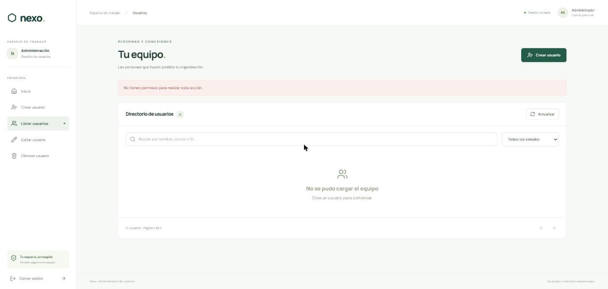 |  |

---

## Guía 07 · Inyección de dependencias, despacio y con objetos reales

**Qué hice** (commit `01b6a02`): `src/bootstrap/container.ts`, que arma el árbol de objetos con constructores, sin decoradores ni librerías:

```
BrowserSessionStore(localStorage)
  └─> HttpClient('/api', store, onUnauthorized)
        └─> UserHttpAdapter(http)
              └─> UserApplicationService(gateway, store)  = useCases
```

- **¿Dónde hacemos provide?** En `main.ts`: `createApp(App).provide(USE_CASES, useCases).use(router).mount('#app')`. Cada vista llama `useApplication()`, que hace `inject(USE_CASES)` y falla con un mensaje claro si falta el proveedor. Las vistas nunca hacen `new` de un servicio.
- **¿Por qué un evento para la sesión vencida?** `HttpClient` recibe un callback genérico; la composición lo convierte en el evento `session-expired` y `main.ts` lo escucha para redirigir. Así el archivo HTTP no depende de Vue Router y se evita el ciclo composición → router → servicio.
- **¿Cómo probar que la DI es real?** Las pruebas unitarias construyen el servicio con un gateway falso y un `Storage` en memoria; el servicio no se entera.
- **Pregunta para cerrar: ¿qué cambiarías para guardar la sesión de otra manera?** Otro adaptador que cumpla `SessionStore`, conectado en `container.ts`. En este proyecto ni siquiera hace falta una clase nueva para usar `sessionStorage`: bastaría con `new BrowserSessionStore(sessionStorage)`, porque recibe cualquier `Storage`. Las vistas no cambian.

---

## Guía 08 · Entrypoint: desde el HTML hasta la pantalla que ves

**Qué hice** (commit `75d76eb`): `main.ts`, `context.ts`, `router.ts` y `App.vue`. En ese commit `vue-tsc` todavía reporta 4 errores esperados porque el router importa las vistas que llegan con las guías 09 y 10; la guía 01 avisa de esos errores temporales.

**Secuencia de arranque:** `index.html` → `/src/main.ts` → `createAppRouter(useCases)` → escucha `session-expired` y `storage` → `createApp(App).provide(...).use(router).mount('#app')`.

- **Rutas:** `/login` y `/registro` son públicas (`meta.public`); `/`, `/usuarios`, `/usuarios/crear`, `/usuarios/editar`, `/usuarios/eliminar` y `/usuarios/:id/editar` son privadas; cualquier otra redirige a `/`.
- **Guard `beforeEach`:** si la ruta no es pública y no hay sesión, devuelve `/login?redirect=<ruta original>`. `meta.public` no es seguridad automática: es una bandera que nuestro guard interpreta, y la seguridad real la pone la API.
- **`App.vue`:** si la ruta es pública muestra solo la vista; si no, el marco con menú (`RouterLink` + `<component :is="item.icon">`), la cabecera y el cierre de sesión.
- **Pestañas:** el evento `storage` hace que cerrar sesión en una pestaña mande a login a las demás.
- **Redirección segura en el login:** `AuthView` solo acepta un `redirect` que empiece por `/` y no por `//`, para no mandar a la persona a otro sitio.

**Prueba manual:** sin sesión escribí `/usuarios` y terminé en `/login?redirect=/usuarios`. Al iniciar sesión volví a `/usuarios` con el marco privado.

| Sin sesión: el guard manda a login | Después del login: vuelve a la ruta pedida |
| --- | --- |
| 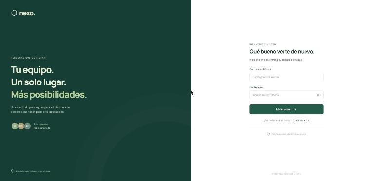 |  |

---

## Guía 09 · Las vistas de login y bienvenida, con su lógica y su HTML

**Qué hice** (commit `139a936`): `AuthView.vue` y `HomeView.vue`.

- **`AuthView`:** `ref` para correo, contraseña, `show`, `busy` y `error`. `submit` sigue el patrón `try/catch/finally`: activa `busy`, llama `app.login`, redirige, y si falla muestra el mensaje. `@submit.prevent` evita recargar la página. Accesibilidad: cada `label for` coincide con su `id`, el botón del ojo tiene `aria-label` y los errores usan `role="alert"`.
- **`HomeView`:** lee la sesión una vez; si el rol es ADMIN o REVIEWER carga la lista en `onMounted`. Las cifras se calculan desde la lista completa. Al rol MEMBER le explica que no puede consultar el directorio. La ilustración lleva `aria-hidden="true"` porque es decorativa.
- **Presentación ≠ permiso:** ocultar un botón no protege nada; quien decide es la API (403). La vista solo evita mostrar acciones que de todos modos fallarían.

| Credenciales incorrectas (401 del login) | Bienvenida con cifras y rol |
| --- | --- |
| 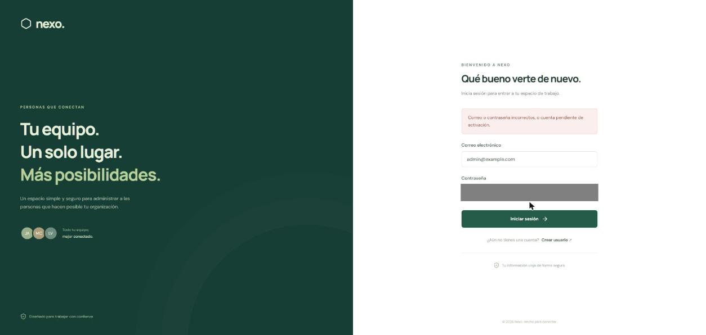 | 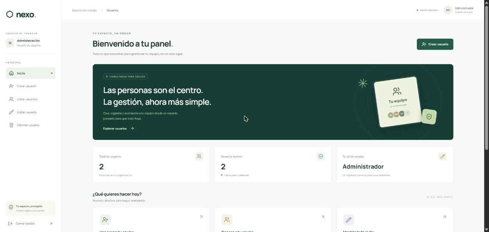 |

**Prácticas** (rama `ejercicios`):
1. **Vista rápida de 4 a 2 filas:** `users.slice(0, 2)`. Se ven dos filas y el total sigue en 7, porque `slice` recorta una copia y no la lista original.
2. **Etiqueta visible de ADMIN:** cambié `roleLabel.ADMIN` a "Administrador general". Cambia el texto en toda la interfaz, pero a la API sigue viajando `ADMIN`: el template usa `roleLabel[user.role]` y el mapper envía `u.role`.

| Dos filas, total 7, etiqueta nueva |
| --- |
| 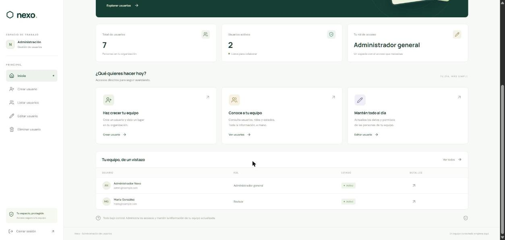 |

---

## Guía 10 · Crear, consultar, editar y eliminar desde Vue

**Qué hice** (commit `a823cab`): `UserFormView.vue` y `UsersView.vue`.

- **`UserFormView`** tiene tres modos: registro público (`meta.register`, siempre MEMBER), creación (con rol) y edición (`params.id`, con estado). El UUID se genera **una vez** al abrir el formulario, no en el `submit`: si se pierde la respuesta y se reintenta con el mismo ID y datos, el backend responde 200 en lugar de crear otro. En edición, si el rol no es ADMIN, el `fieldset` queda deshabilitado; la contraseña vacía conserva la anterior.
- **`UsersView`:** `filtered`, `pages`, `currentPage` y `visible` son `computed`. Con 8 por página, 17 usuarios dan 3 páginas; buscar o filtrar vuelve a la página 1. El modal usa `Teleport` a `body`, pone el foco en Cancelar, atrapa el Tab dentro del diálogo, cierra con Esc y devuelve el foco al botón que lo abrió.

**¿Qué función maneja cada paso?** `submit` crea o guarda; `load` trae la lista; `confirm` abre el modal; `close` lo cierra sin borrar; `remove` hace el `DELETE`.

**Práctica guiada en Chrome:**

| Paso | Evidencia |
| --- | --- |
| Crear un usuario (rol Revisor) | 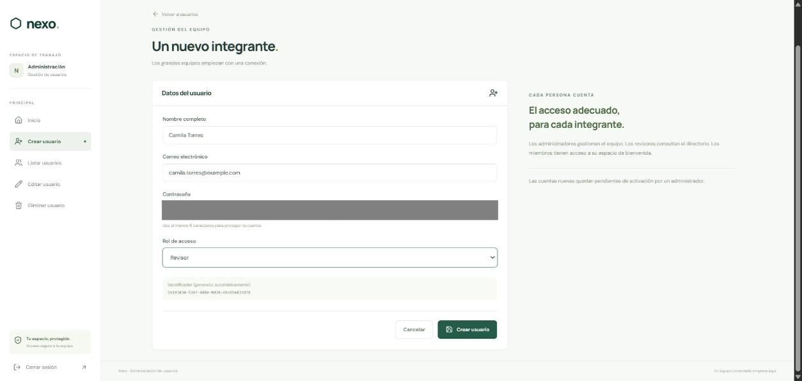 |
| Queda pendiente de activación (201) | 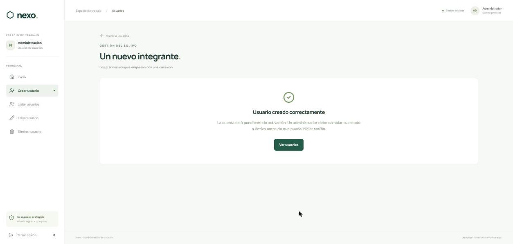 |
| Buscarlo | 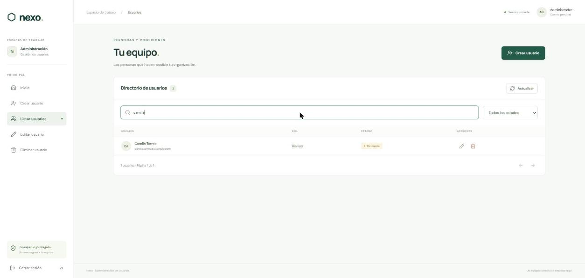 |
| Editar: Pendiente → Activo |  |
| Guardado correcto |  |
| Abrir confirmación y cancelar: el usuario sigue |  |
| Confirmar: `DELETE /api/users/{id}` → 204 |  |

Además: entrando con la cuenta activada (rol Revisor) desaparecen los botones de eliminar y el lápiz dice "Ver"; el registro público crea la cuenta pendiente y el login de esa cuenta se rechaza.

| Vista de Revisor | Registro público | Login de cuenta pendiente |
| --- | --- | --- |
| 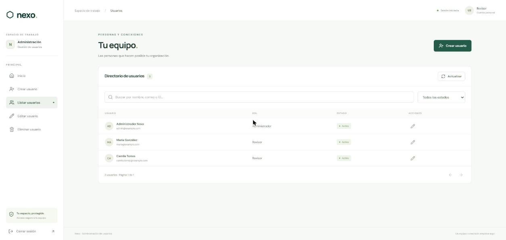 | 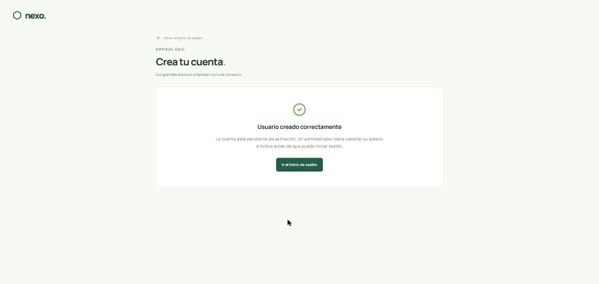 |  |

---

## Guía 11 · Entender el CSS del proyecto sin aprenderlo de memoria

**Qué hice** (commit `b41d4d2`): `styles.css` global, importado por `main.ts`. Las vistas no tienen `<style>` propio para compartir botones, tablas y formularios.

- `@import` de DM Sans y Manrope desde Google Fonts (si no cargan, queda `sans-serif`).
- `:root` define variables (`--green`, `--dark`, `--muted`, `--border`…) que se usan con `var(...)`.
- `* { box-sizing: border-box }`: el ancho incluye relleno y borde.
- Distribución con Flexbox (35 reglas) y Grid (15 reglas).
- Diseño adaptable con `@media` en 1450, 1100, 800 y 540 px.
- Estados `:hover`, `:focus-visible` (contorno visible con teclado) y `:disabled`. El CSS solo se ve deshabilitado; lo que impide usar el control es el atributo `disabled` que pone Vue.
- `@media (prefers-reduced-motion: reduce)` quita transiciones a quien lo pidió.
- Las insignias de estado usan una clase derivada del dato: `:class="user.status.toLowerCase()"`.

**Práctica:** cambié `--green` en vivo en Chrome (como en DevTools, desde la consola de la página) de `#245b49` a `#6d28d9`. Solo cambió el color del botón principal; datos, validaciones y peticiones siguieron iguales. Luego la restauré. Así se ve que estilos y casos de uso no están mezclados.

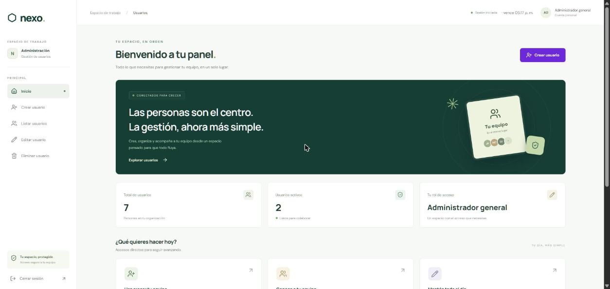

La comprobación automática del diseño adaptable está en el escenario 4 de Playwright (390×844 y 1440×1100):

| Móvil 390×844 | Escritorio 1440×1100 |
| --- | --- |
| 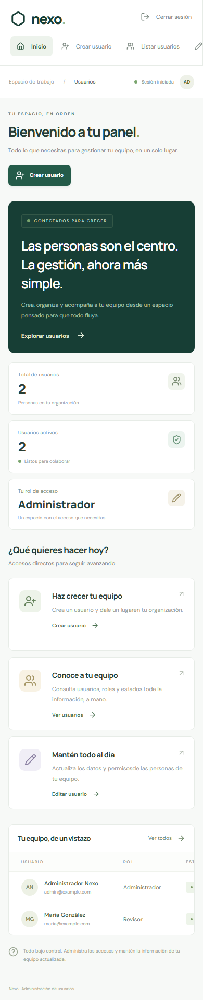 |  |

---

## Guía 12 · Las pruebas: qué comprueban y cómo ejecutarlas

**Qué hice** (commit `35e6a25`): `vitest.config.ts`, `playwright.config.ts`, `tests/` y `postman/`. Instalé Postman CLI con `npm install -g postman-cli` (1.94.0; la guía pide 1.70 o superior) y Chromium con `npx playwright install chromium`.

| Nivel | Herramienta | ¿Abre navegador? | ¿Llama a la API real? | Resultado |
| --- | --- | --- | --- | --- |
| Unitario | Vitest | No | No: algunas pruebas sustituyen `fetch` | 8/8 |
| Navegador | Playwright | Sí, sin ventana | No: llama a la simulación local en 4010 | 4/4 |

**Las 8 unitarias:** normaliza datos y no llama al puerto con contraseña inválida · rechaza roles y estados ajenos al dominio · elimina datos corruptos del almacenamiento · reutiliza Bearer y borra la sesión con 401 · un 403 conserva la sesión · un 401 tardío no borra una sesión nueva · el login no envía un token viejo · el PUT omite la contraseña vacía y DELETE acepta cuerpo vacío.

**Los 4 escenarios de navegador:** sesión persistente y CRUD completo · 403 y 401 · registro pendiente y credenciales inválidas · pantallas adaptables y navegación protegida.

```bash
npm test                 # unitarias
npm test -- -t 'un 403'  # un grupo concreto
npm run test:e2e         # Playwright levanta la simulación (4010) y Vite (5173)
```

Para practicar a mano (lo que usé en Chrome), en dos terminales:

```bash
postman simulation run postman/simulations/users/users.sim.yaml --port 4010 --no-history
API_PROXY_TARGET=http://127.0.0.1:4010/user-service npm run dev
```

Un mock de `fetch` no prueba el proxy, y la simulación no prueba que un despliegue real tenga base de datos, permisos o CORS bien configurados. Hay que nombrar con precisión qué se ejecutó.

---

## Guía 13 · Seguir la aplicación completa y aprender a depurarla

**El login de principio a fin:** `AuthView.submit` → `UserApplicationService.login` (valida correo y contraseña) → `UserHttpAdapter.login` → `HttpClient.request('/auth/login', 'POST', …, false)` → proxy de Vite → API → token → validación de claims → `BrowserSessionStore.save` → `router.replace(redirect)`.

**Crear usuario:** la vista conserva ID y campos → comando → el servicio construye `User` y `UserPassword` (si fallan, no llama al puerto) → el adaptador arma el JSON → respuesta → `User` → `UserResponse` → la pantalla explica la activación pendiente.

**Peticiones reales observadas en Chrome** (registro de red de la pestaña, extracto):

| Método | URL | Estado | Qué pasó |
| --- | --- | --- | --- |
| POST | `/api/users` | 201 | Creación de usuario (queda PENDING) |
| POST | `/api/auth/login` | 401 | Contraseña incorrecta o cuenta pendiente |
| POST | `/api/auth/login` | 200 | Login correcto |
| GET | `/api/users` | 200 | Listado |
| GET | `/api/users` | 403 | Falla inyectada: permisos, la sesión sigue |
| GET | `/api/users` | 401 | Falla inyectada: sesión borrada, vuelve a login |
| DELETE | `/api/users/5a1d3434-…` | 204 | Borrado confirmado desde el modal |

En el almacenamiento del navegador, la clave `nexo.session` contenía `userId`, `role`, `expiresAt` y el token (no lo copio: la guía pide no compartir tokens).

**Orden de depuración aplicado** a un login fallido: (1) ¿se envió o lo frenó la validación HTML? (2) ¿la URL empieza por `/api/auth/login`? (3) ¿el proxy apunta al servicio correcto? (4) ¿fue 401, 403, 500 o fallo de red? (5) ¿la cuenta está activa? (6) si fue 200, ¿trae `accessToken` y los claims? En el caso de la cuenta pendiente, la respuesta fue 401 y la causa era el paso 5.

### Ejercicios de la tabla 3 (rama `ejercicios`)

| Ejercicio | Qué toqué | Cómo supe que funcionó | Estado |
| --- | --- | --- | --- |
| Cambiar una etiqueta de rol | `roleLabel` en `context.ts` | "Administrador general" en pantalla; a la API sigue yendo `ADMIN` | Hecho |
| Dos usuarios en la bienvenida | `slice(0, 2)` en `HomeView` | Dos filas, total 7 | Hecho |
| Paginar de cinco en cinco | `pageSize = 5` en `UsersView` | 7 usuarios → "Página 1 de 2"; la 2 muestra 2 | Hecho |
| Columna con el ID | Template de `UsersView` y un estilo | Columna nueva; el DTO y la petición no cambian | Hecho |
| Hora de vencimiento | `App.vue` formatea `expiresAt` (ms) | "vence 05:17 p. m." en la cabecera, sin cierre automático | Hecho |
| Mensajes de validación por campo | Contrato de errores + formularios | — | Análisis abajo |
| Sesión compartida reactiva | Frontera GUI/estado | — | Análisis abajo |
| Paginación de servidor | Backend, puertos, adaptador y GUI | — | Análisis abajo |

| Etiqueta, columna ID, 5 por página y hora de vencimiento | Página 2 de 2 |
| --- | --- |
|  |  |

**Los tres ejercicios grandes, qué capa cambiaría:**
- **Validación por campo:** hoy `DomainError` lleva solo un mensaje. Habría que agregarle el nombre del campo (por ejemplo `new DomainError(msg, 'email')`), que `HttpClient` lea los errores por campo de un 400 en vez de reemplazarlos por el texto local, y que los formularios guarden un `errors` por campo y lo muestren bajo cada input. El dominio sigue validando.
- **Sesión reactiva:** hoy `App.vue` relee la sesión cuando cambia la ruta (`void route.fullPath`). Se podría exponer la sesión como un `ref` compartido, actualizado por un `SessionStore` que notifique cambios (y por el evento `storage`). Así el rol se actualiza sin depender de navegar. El dominio y la aplicación no cambian; cambia la frontera GUI/estado.
- **Paginación de servidor:** primero hay que acordarla con el backend (`GET /api/users?page=&size=` y una respuesta con total). Luego cambian `UserGateway.list`, el adaptador, la consulta `ListUsersQuery` y `UsersView`, que dejaría de recortar en memoria. No se puede hacer solo en el frontend.

---

## Guía 14 · Inventario: ningún archivo queda sin ubicar

| Archivos | Commit / guía |
| --- | --- |
| `package.json`, `package-lock.json`, `.gitignore`, `.env.example`, `LICENSE` | `42643b9` · guía 01 |
| `tsconfig.json`, `vite.config.ts`, `index.html` | `a042762` · guía 03 |
| `src/domain/**` (constantes, errores, objetos de valor, modelos, puertos de salida) | `4c6551b` · guía 04 |
| `src/application/**` (DTO, mapper, puertos de entrada, servicio) | `62cf2a5` · guía 05 |
| `src/adapters/**` (DTO HTTP, mapper, `HttpClient`, `UserHttpAdapter`, `BrowserSessionStore`) | `8dda93e` · guía 06 |
| `src/bootstrap/container.ts` | `01b6a02` · guía 07 |
| `src/main.ts`, `src/entrypoint/gui/{context.ts,router.ts,App.vue}` | `75d76eb` · guía 08 |
| `views/AuthView.vue`, `views/HomeView.vue` | `139a936` · guía 09 |
| `views/UserFormView.vue`, `views/UsersView.vue` | `a823cab` · guía 10 |
| `src/entrypoint/gui/styles.css` | `b41d4d2` · guía 11 |
| `vitest.config.ts`, `playwright.config.ts`, `tests/unit`, `tests/e2e`, `postman/**` | `35e6a25` · guía 12 |
| `docs/` (este documento y las evidencias), `README.md` | guías 13 y 14 |

**Generados o locales (no se escriben a mano ni se suben):** `package-lock.json` (lo genera npm y sí se versiona para reproducir la instalación), `node_modules/` (npm), `dist/` (`npm run build`), `.env` (configuración local), `postman/simulation.log` (Playwright), `test-results/` y `playwright-report/` (Playwright).

---

## Problemas reales encontrados y cómo se resolvieron

| Síntoma | Causa | Solución |
| --- | --- | --- |
| `npm install -D …` falló con `Cannot read properties of null (reading 'edgesOut')` | Error de npm 10.5.1 al resolver las dependencias opcionales de Vitest 5 | Instalar con un npm más nuevo sin tocar el global: `npx -y npm@11 install -D …` |
| Aviso `install-scripts … esbuild (postinstall)` con npm 11 | npm 11 no ejecuta scripts de instalación que no se aprobaron | Se comprobó que `esbuild --version` responde y que el build funciona; no hizo falta desactivar las verificaciones |
| `npm run test:e2e`: "5173 is already used" | El Vite manual seguía abierto y la configuración usa `reuseExistingServer: false` | Detener el servidor manual y repetir (tabla 2 de la guía 13: "Puerto ocupado en E2E") |
| Nombres con tildes dañados al crear usuarios con `curl` | La consola de Windows no envió el JSON en UTF-8 | Reiniciar el mock (`/__reset`) y crear los datos con `fetch` desde Node |

## Cómo ejecutar este repositorio

```bash
npm ci
npm test
npm run build
npx playwright install chromium   # una vez
npm run test:e2e                  # requiere Postman CLI 1.70+ y los puertos 5173 y 4010 libres
```

Para ver los ejercicios: `git switch ejercicios`.
