# Taller Nexo: la app reconstruida guía por guía

`24 nov 2026` · `Osvaldo De Jesus Pacheco Sanabria` · `Profesor John Carlos Arrieta Arrieta`

Reconstruí Nexo desde una carpeta vacía siguiendo las 14 guías, con un commit por guía. La app funciona contra la simulación de Postman y contra el backend real del profesor, que levanté en mi equipo con Docker. Las pruebas unitarias, el build y las 4 pruebas de navegador pasan. Los ejercicios están en la rama `ejercicios`; solo quedó fuera la paginación de servidor, porque necesita cambios en el backend.

## Dónde está todo

Todo está en un solo repositorio: [github.com/OsvaldoDJesus/nexo-desde-cero](https://github.com/OsvaldoDJesus/nexo-desde-cero).

| Qué | Dónde |
| --- | --- |
| App reconstruida | Rama `main` |
| Prácticas y ejercicios | Rama `ejercicios` |
| Este documento | `docs/TALLER.md` y `docs/Taller-Nexo-Vue-TypeScript.pdf` |
| Capturas | `docs/evidencias/` |
| Backend en local | `docs/backend-local/` |
| Proyecto de referencia | [arrietajohn/user-crud-vuejs-app](https://github.com/arrietajohn/user-crud-vuejs-app), licencia MIT |

## Resultado de las pruebas

Todo pasa en las dos ramas.

| Prueba | Comando | `main` | `ejercicios` | Estado |
| --- | --- | --- | --- | --- |
| Tipos | `npx vue-tsc --noEmit` | Sin errores | Sin errores | Hecho |
| Unitarias | `npm test` | 8 de 8 | 13 de 13 | Hecho |
| Build | `npm run build` | Correcto | Correcto | Hecho |
| Navegador | `npm run test:e2e` | 4 de 4 | 4 de 4 | Hecho |
| Recorrido con la simulación | Chrome + Postman CLI | Login, CRUD, roles, registro, 403 y 401 | Ejercicios 1 a 5 | Hecho |
| Recorrido con el backend real | Chrome + user-service | Login, CRUD y "Atrás" tras cerrar sesión | Ejercicios 6 y 7 | Hecho |

Lo corrí en Windows 11 con Node 22.18, npm 10.5.1, Postman CLI 1.94, Playwright 1.64.1 y Docker 29. La guía recomienda Node 26, pero Vite y Vitest aceptan desde la 22.12, así que no hizo falta cambiarlo.

## Cómo la reconstruí

Empecé en una carpeta vacía (camino B de la guía 01) y escribí cada capa en el orden de las guías, con un commit por guía. Desde la guía 04 revisé los tipos después de cada capa. El commit de la guía 08 todavía no compila solo, porque el router importa vistas que llegan en las guías 09 y 10.

| Guía | Tema | Commit | Estado |
| --- | --- | --- | --- |
| 01 | Equipo, dependencias y entorno | `42643b9` | Hecho |
| 02 | Leer TypeScript y Vue | Práctica en `ejercicios` | Hecho |
| 03 | Archivos de configuración | `a042762` | Hecho |
| 04 | Dominio | `4c6551b` | Hecho |
| 05 | Casos de uso | `62cf2a5` | Hecho |
| 06 | Adaptadores HTTP y de sesión | `8dda93e` | Hecho |
| 07 | Inyección de dependencias | `01b6a02` | Hecho |
| 08 | Arranque, router y marco | `75d76eb` | Hecho |
| 09 | Login y bienvenida | `139a936` | Hecho |
| 10 | Crear, consultar, editar y eliminar | `a823cab` | Hecho |
| 11 | Hoja de estilos | `b41d4d2` | Hecho |
| 12 | Pruebas y simulación | `35e6a25` | Hecho |
| 13 | Recorrido, depuración y ejercicios | Documento y rama `ejercicios` | Hecho |
| 14 | Inventario | Este documento | Hecho |

## Guía 01 · Del equipo vacío a la app arrancada

Instalé las librerías con los comandos exactos de la guía y después dejé el manifiesto igual al del proyecto: `private`, `type: module` y los cinco scripts.

```bash
npm install vue@3.5.44 vue-router@4.6.4 lucide-vue-next@0.468.0
npm install -D typescript@5.9.3 vite@7.3.7 @vitejs/plugin-vue@6 vue-tsc@3 @types/node@24 vitest@5.1.0 @playwright/test@1.64.1
```

- **¿Qué corre en Node y qué en el navegador?** En Node corren npm, Vite con su proxy, vue-tsc, Vitest, Playwright y el build. En el navegador corre la app ya compilada: Vue, el router, las vistas, `fetch` y `localStorage`.
- **¿Por qué npm se ejecuta en la carpeta correcta?** Porque busca `package.json` en la carpeta actual. De ahí salen los scripts, `node_modules` y el archivo de bloqueo.
- **¿Por qué el login abre con el backend apagado?** Vite entrega el HTML, el CSS y el JavaScript, y con eso se dibuja el formulario. El backend solo se usa al enviar el login. La conexión real la probé contra user-service: `POST /api/auth/login` respondió 200.

## Guía 02 · Leer TypeScript y Vue

Esta guía no agrega archivos. Estos son sus conceptos tal como aparecen en Nexo.

| Concepto | Dónde aparece | Qué significa |
| --- | --- | --- |
| `interface` | `LoginCommand`, `UserGateway` | La forma de un objeto, sin lógica |
| `Session \| null` | `SessionStore.get()` | Hay sesión o no la hay |
| `unknown` | `errorMessage(e: unknown)` | Hay que comprobar qué es antes de usarlo |
| Genéricos | `request<T>()`, `Promise<User>` | Quien llama dice qué tipo espera |
| `Omit` y `?` | `UpdateUserCommand` | Reutiliza campos, quita uno y lo vuelve opcional |
| `?.`, `??` y `\|\|` | `session?.token` | `??` solo reemplaza `null` y `undefined`; `\|\|` también `''` y `0` |
| `as const` | `USER_ROLES` | La lista se vuelve un tipo: `'ADMIN' \| 'MEMBER' \| 'REVIEWER'` |
| `async` / `await` | Servicio, adaptador y vistas | Espera la respuesta sin congelar la pantalla |
| `<script setup lang="ts">` | Todas las vistas | Lo que se declara ahí se usa directo en la plantilla |
| `ref` y `computed` | `busy`, `filtered` | Estado reactivo y valores que se recalculan solos |
| Directivas | `v-model`, `v-if`, `v-for`, `@submit.prevent` | Enlace de datos, condiciones, listas y eventos |

Un `ref` no es `localStorage`. El primero es reactivo; el segundo es almacenamiento del navegador.

**Práctica:** `SaludoPractica.vue` en la rama `ejercicios`, ruta `/practica/guia-02`. El input usa `v-model`, un botón cambia el nombre a "María", un `computed` lo pasa a mayúsculas y un `v-if` avisa cuando tiene menos de 3 letras.

| Nombre corto: aparece el aviso | El botón cambia el input y el `computed` |
| --- | --- |
|  |  |

## Guía 03 · Qué dice cada archivo de configuración

Cada archivo de la raíz tiene una sola tarea.

| Archivo | Para qué sirve |
| --- | --- |
| `package.json` | Nombre, scripts y dependencias. `private` evita publicarlo en npm; `type: module` activa `import` y `export` |
| `tsconfig.json` | `strict`, `moduleResolution: Bundler` y `noEmit`: TypeScript revisa y Vite transforma. `lib: DOM` permite usar `window` y `fetch` |
| `vite.config.ts` | Plugin de Vue y proxy: `/api` va a `API_PROXY_TARGET`, o a `localhost:8080` si no hay `.env` |
| `index.html` | El `div#app` y el script que carga `/src/main.ts` |
| `.env.example` | `VITE_API_BASE_URL` llega al navegador; `API_PROXY_TARGET` solo lo usa Vite |
| `.gitignore` | `node_modules`, `dist`, `.env`, `test-results`, `playwright-report` y `*.log` |

Dos cuidados: nada secreto va en una variable `VITE_*`, porque termina en el navegador. Y si el destino del proxy termina en `/api`, las rutas quedan `/api/api`.

## Guía 04 · La arquitectura y el dominio

El dominio decide qué datos son válidos y no conoce Vue, `fetch` ni `localStorage`.

| Capa | Carpeta | Pregunta que responde |
| --- | --- | --- |
| Dominio | `src/domain` | ¿Qué datos y reglas son válidos? |
| Aplicación | `src/application` | ¿Qué pasos sigue una operación? |
| Adaptadores | `src/adapters` | ¿Cómo hablo con algo externo? |
| Entrada | `src/entrypoint/gui` | ¿Cómo interactúa la persona? |
| Composición | `src/bootstrap` | ¿Qué objetos concretos conecto? |

Los objetos de valor validan al crearse: `UserId` no vacío, `UserName` de 3 letras o más, `UserEmail` en minúsculas y con forma de correo, `UserPassword` de 8 o más. `User` rechaza roles y estados que no existen. `UserGateway` y `SessionStore` son puertos: dicen qué se necesita, no cómo se hace.

- **¿Cambiar HTTP por memoria obliga a tocar `UserName`?** No. El dominio no sabe de HTTP.
- **¿`User` decide a qué URL enviarse?** No. Eso lo hace el adaptador.
- **¿Un tipo correcto garantiza que el JSON del servidor es válido?** No. Los tipos desaparecen al compilar; por eso `fromApiUser` construye un `User` y la validación corre al ejecutar. La prueba "rechaza roles y estados ajenos al dominio" lo comprueba.
- **Nombre de dos letras:** el `minlength` del input frena el envío. Si se salta, `UserName` lanza el error antes de llamar al puerto.

`ApiError` conoce códigos HTTP aunque vive con los errores del dominio. Es una concesión del proyecto que la guía señala.

## Guía 05 · Ordenar los pasos de cada operación

`UserApplicationService` ordena los pasos: valida con el dominio, llama al puerto y guarda la sesión.

- **Login:** normaliza el correo, exige contraseña, llama al gateway, guarda la sesión y devuelve solo `userId`, `role` y `expiresAt`.
- **Crear:** construye `User` en `PENDING` y `UserPassword`. Si alguno falla, no llama al puerto.
- **Listar:** filtra en memoria por nombre, correo o ID.
- **Editar:** solo crea `UserPassword` si llegó una contraseña.
- **Cerrar sesión:** borra la sesión local. La API no tiene cierre de sesión y el token no se revoca.

Busqué imports de Vue en dominio y aplicación y no hay ninguno. El servicio recibe `UserGateway` y `SessionStore` por el constructor, así que acepta cualquier objeto que cumpla esos puertos. La primera prueba unitaria lo hace con un gateway falso.

## Guía 06 · Adaptadores: llevar las operaciones a HTTP

Los adaptadores traducen entre HTTP y el modelo; el resto de la app no ve JSON ni cabeceras.

- **`UserApiMapper`:** pasa de la API al dominio y al revés. Si no hay contraseña, el PUT no envía el campo.
- **`BrowserSessionStore`:** guarda la sesión en `localStorage` como `nexo.session`. Si está dañada, la borra. Recibe un `Storage`, por eso las pruebas usan uno en memoria.
- **`HttpClient`:** agrega `Accept`, `Content-Type` y `Authorization: Bearer`, y corta a los 30 segundos. `fetch` no falla con un 401 o un 500, así que revisa el estado.
- **401:** borra la sesión solo si el token guardado es el mismo que usó la petición. Así una respuesta vieja no cierra un login nuevo.
- **403:** muestra "No tienes permisos" y deja la sesión. El usuario existe; lo que no tiene es permiso para esa acción.
- **`UserHttpAdapter`:** el login y el registro no envían token. Del JWT lee `sub`, `role`, `exp` y `tokenType`. Leer el token no es verificar su firma; eso lo hace el servidor.

Lo probé en Chrome forzando cada error desde la simulación:

| 403: mensaje de permisos y la sesión sigue | 401: se borra la sesión y vuelve a login |
| --- | --- |
|  | 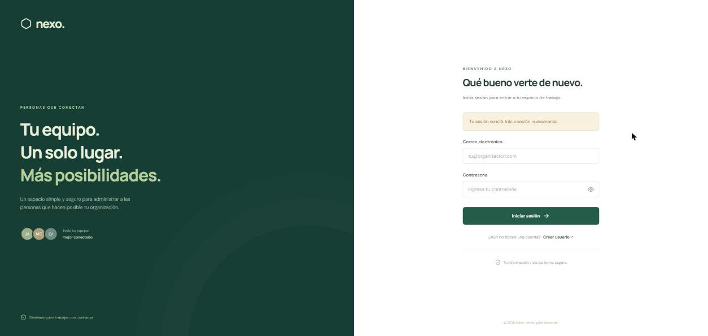 |

## Guía 07 · Inyección de dependencias

`container.ts` arma los objetos con constructores y `main.ts` los entrega a Vue con `provide`. No hay framework de inyección.

```
BrowserSessionStore(localStorage)
  HttpClient('/api', store, onUnauthorized)
    UserHttpAdapter(http)
      UserApplicationService(gateway, store)
```

- **¿Dónde se hace `provide`?** En `main.ts`, antes de instalar el router y montar. Cada vista pide los casos de uso con `useApplication()` y nunca hace `new`.
- **¿Por qué un evento para la sesión vencida?** `HttpClient` recibe una función; la composición la convierte en el evento `session-expired` y `main.ts` redirige. Así el cliente HTTP no depende del router y no hay un ciclo de imports.
- **¿Cómo se prueba?** Las pruebas unitarias le pasan al servicio un gateway falso y un almacenamiento en memoria.
- **¿Qué cambia para guardar la sesión de otra forma?** Solo la composición. Para usar `sessionStorage` basta `new BrowserSessionStore(sessionStorage)`; las vistas no se enteran.

## Guía 08 · Del HTML a la pantalla

`index.html` carga `main.ts`, que crea el router, escucha la sesión y monta `App`.

- **Rutas:** `/login` y `/registro` son públicas. Inicio, usuarios, crear, editar y eliminar son privadas. Cualquier otra lleva a `/`.
- **Guard:** si la ruta es privada y no hay sesión, manda a `/login?redirect=` con la ruta original. `meta.public` es una marca que lee el guard, no una protección por sí sola.
- **`App.vue`:** en rutas públicas muestra solo la vista; en las privadas, el menú, la cabecera y el botón de salir.
- **Pestañas:** el evento `storage` hace que cerrar sesión en una pestaña lleve a las demás al login.
- **Redirección segura:** el login solo acepta un `redirect` que empiece por `/` y no por `//`.

Hice la prueba manual completa:

1. Sin sesión abrí `/usuarios` y terminé en `/login?redirect=/usuarios`.
2. Al entrar volví a `/usuarios`.
3. Contra el backend real cerré sesión y pulsé "Atrás". No apareció la página privada: el guard volvió a pedir el login. El historial apunta a `/usuarios` porque el cierre de sesión usa `router.replace`.

| Sin sesión | Después del login | "Atrás" tras cerrar sesión |
| --- | --- | --- |
|  | 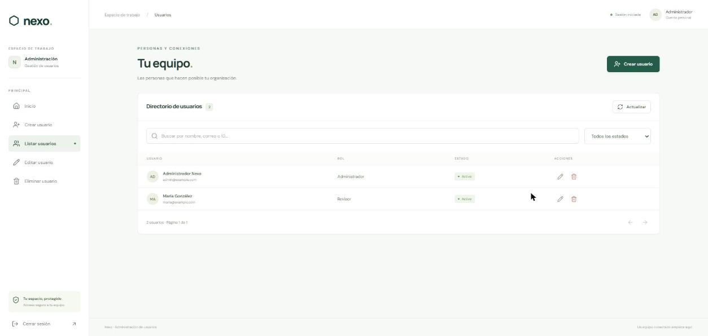 | 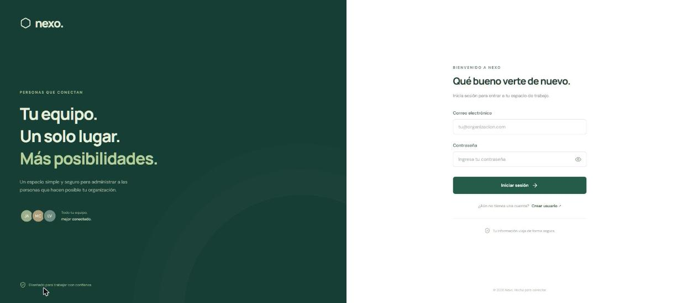 |

## Guía 09 · Las vistas de login y bienvenida

Las dos vistas solo presentan y llaman casos de uso; las reglas siguen en el dominio y los permisos en la API.

- **`AuthView`:** `submit` activa `busy`, llama `app.login`, redirige y, si falla, muestra el error. `@submit.prevent` evita recargar. Cada `label` apunta a su input, el botón del ojo tiene `aria-label` y los errores usan `role="alert"`.
- **`HomeView`:** carga la lista en `onMounted` solo para ADMIN y REVIEWER. Las cifras salen de la lista completa. A un MEMBER le explica que no puede ver el directorio.
- **Presentación y permisos:** esconder un botón no protege nada. Quien decide es la API, con un 403.

| Credenciales incorrectas | Bienvenida |
| --- | --- |
|  |  |

Las dos prácticas están en la rama `ejercicios`:

- **Dos filas en la vista rápida:** con `slice(0, 2)` se ven dos y el total sigue en 7, porque `slice` recorta una copia.
- **Etiqueta de ADMIN:** la cambié a "Administrador general". Cambia el texto, pero a la API sigue yendo `ADMIN`.


## Guía 10 · Crear, consultar, editar y eliminar

`UserFormView` crea y edita; `UsersView` lista, filtra, pagina y borra.

- **Tres modos del formulario:** registro público (siempre MEMBER), creación (con rol) y edición (con estado). En edición, si el rol no es ADMIN, el formulario queda bloqueado. La contraseña vacía conserva la anterior.
- **El UUID se genera al abrir el formulario, no al enviarlo.** Si se pierde la respuesta y se reintenta con el mismo ID y los mismos datos, el backend responde 200 y no crea otro usuario.
- **Directorio:** `filtered`, `pages`, `currentPage` y `visible` son `computed`. Con 8 por página, 17 usuarios son 3 páginas. Buscar o filtrar vuelve a la página 1.
- **Modal de borrado:** abre con el foco en Cancelar, no deja salir con Tab, se cierra con Esc y devuelve el foco al botón que lo abrió.
- **Quién hace qué:** `submit` guarda, `load` trae la lista, `confirm` abre el modal, `close` lo cierra y `remove` borra.

Hice la práctica guiada en Chrome:

| Paso | Captura |
| --- | --- |
| Crear una usuaria con rol Revisor |  |
| Queda pendiente de activación |  |
| Buscarla |  |
| Cambiar el estado a Activo | 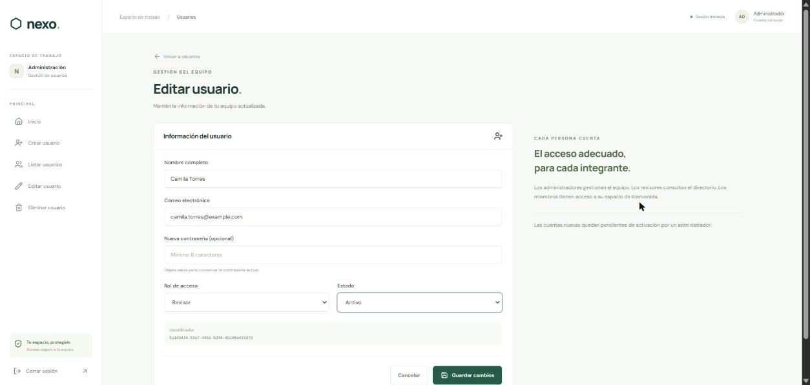 |
| Guardar | 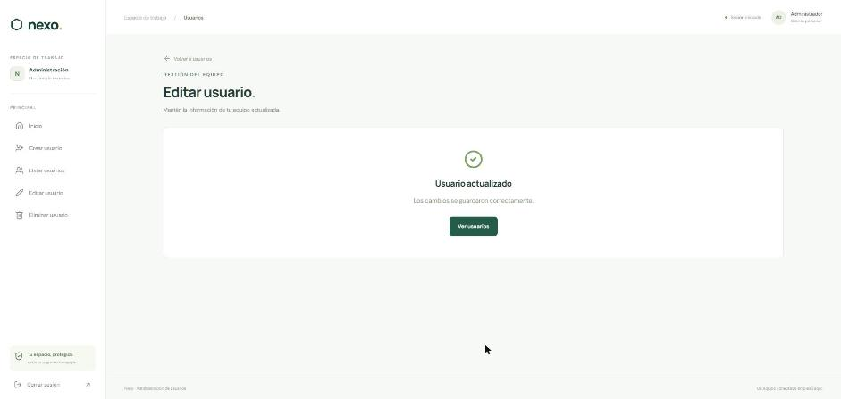 |
| Abrir el modal y cancelar: sigue en la lista | 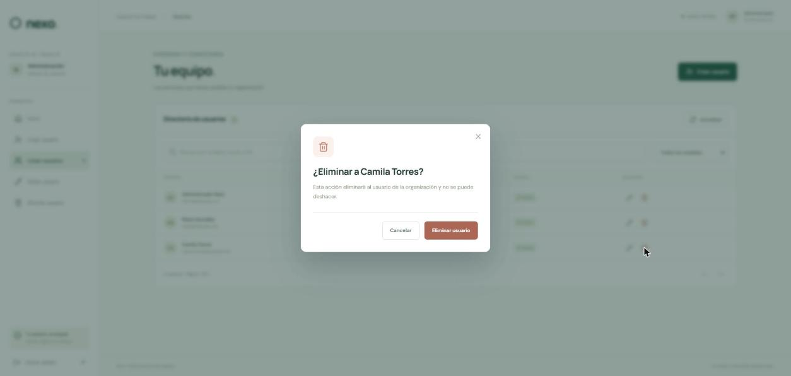 |
| Confirmar: `DELETE` con 204 | 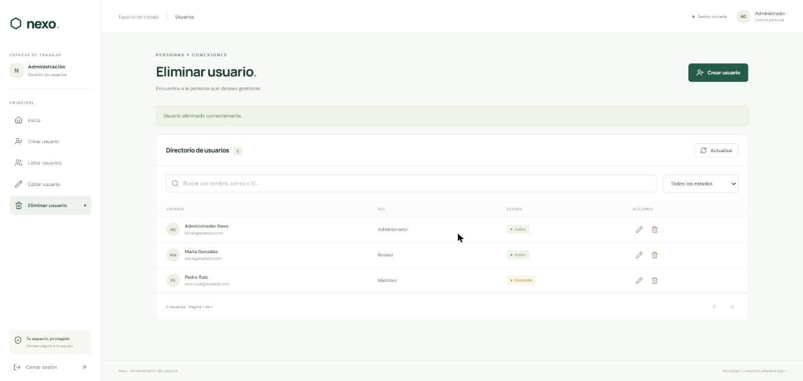 |

También probé los roles: con la cuenta de Revisora no aparecen los botones de borrar. Y el registro público deja la cuenta pendiente, así que su login se rechaza.

| Vista de Revisora | Registro público | Login de cuenta pendiente |
| --- | --- | --- |
|  |  |  |

## Guía 11 · El CSS del proyecto

Hay una sola hoja global, importada en `main.ts`, para que botones, tablas y formularios se vean igual en todas las vistas.

- Fuentes DM Sans y Manrope desde Google Fonts, con `sans-serif` de respaldo.
- Variables en `:root` (`--green`, `--dark`, `--muted`, `--border`) que se usan con `var()`.
- `box-sizing: border-box` para que el ancho incluya relleno y borde.
- Flexbox en 35 reglas y Grid en 15.
- Cortes para pantallas en 1450, 1100, 800 y 540 px.
- Estados `:hover`, `:focus-visible` y `:disabled`. El CSS solo se ve apagado; lo que bloquea el botón es el atributo `disabled` que pone Vue.
- `prefers-reduced-motion` quita las transiciones a quien lo pidió.

Hice las dos prácticas en vivo en Chrome, sin tocar el código, y después restauré los valores:

- **`--green` a morado:** solo cambió el botón principal. Datos, validaciones y peticiones siguieron iguales.
- **`padding` de `.action-card` de 27px a 8px 10px:** las tarjetas se achicaron y nada más cambió.

| `--green` cambiada | Tarjetas antes | Tarjetas después |
| --- | --- | --- |
|  | 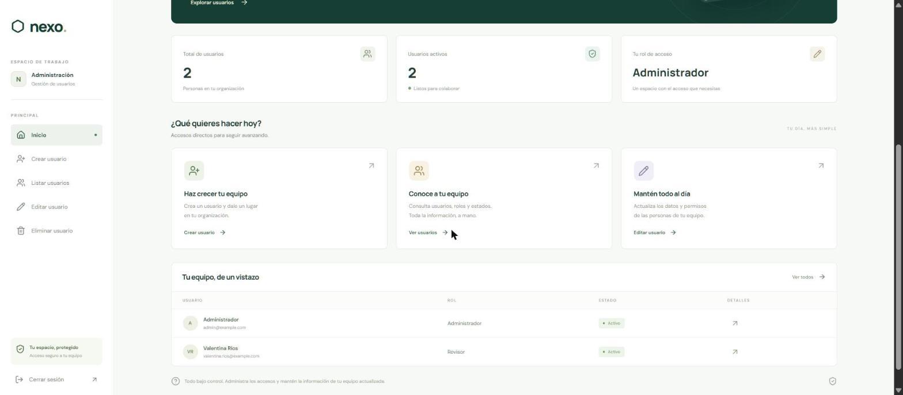 | 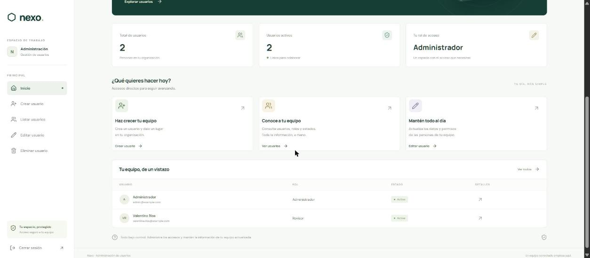 |

La prueba de navegador 4 revisa el diseño en móvil y escritorio:

| Móvil 390×844 | Escritorio 1440×1100 |
| --- | --- |
|  | 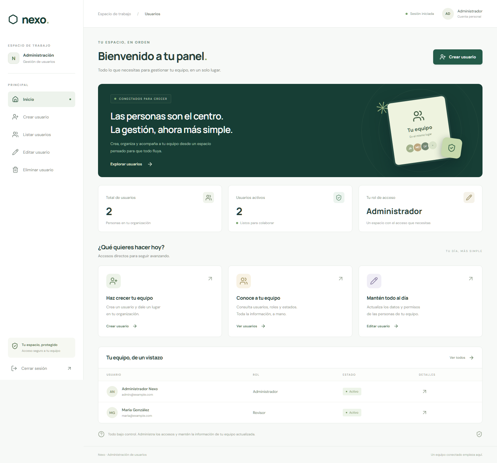 |

## Guía 12 · Las pruebas

Hay dos niveles: las unitarias revisan piezas sueltas y las de navegador revisan que una persona pueda completar una tarea.

| Nivel | Herramienta | ¿Abre navegador? | ¿Usa la API real? | Resultado |
| --- | --- | --- | --- | --- |
| Unitario | Vitest | No | No; algunas reemplazan `fetch` | 8 de 8 |
| Navegador | Playwright | Sí, sin ventana | No; usa la simulación en el puerto 4010 | 4 de 4 |

Las 8 unitarias revisan:
- la normalización y el rechazo de una contraseña corta;
- roles y estados inválidos;
- el almacenamiento dañado;
- el Bearer con el 401;
- el 403;
- el 401 tardío;
- que el login no envíe un token viejo;
- el PUT sin contraseña y el DELETE con 204.

Las 4 de navegador recorren:
- la sesión y el CRUD;
- el 403 y el 401;
- el registro pendiente;
- las pantallas de móvil y escritorio.

Instalé Postman CLI con `npm install -g postman-cli` y Chromium con `npx playwright install chromium`. Para practicar a mano usé dos terminales:

```bash
postman simulation run postman/simulations/users/users.sim.yaml --port 4010 --no-history
API_PROXY_TARGET=http://127.0.0.1:4010/user-service npm run dev
```

La simulación no prueba que un servidor real tenga bien la base de datos, los permisos o CORS. Por eso también lo probé contra user-service.

## Guía 13 · Seguir la app y depurarla

Seguí el login y la creación de un usuario desde la vista hasta el servidor y de vuelta.

- **Login:** `AuthView.submit`, `UserApplicationService.login`, `UserHttpAdapter.login`, `HttpClient`, proxy de Vite, API, validación del token, `BrowserSessionStore.save` y redirección.
- **Crear:** la vista conserva ID y campos, el servicio valida con el dominio, el adaptador arma el JSON y la respuesta vuelve como `UserResponse`.

Estas son las peticiones que vi en Chrome con la simulación:

| Método | Ruta | Estado | Qué pasó |
| --- | --- | --- | --- |
| POST | `/api/users` | 201 | Usuario creado en `PENDING` |
| POST | `/api/auth/login` | 401 | Contraseña incorrecta o cuenta pendiente |
| POST | `/api/auth/login` | 200 | Login correcto |
| GET | `/api/users` | 200 | Listado |
| GET | `/api/users` | 403 | Falla forzada: la sesión sigue |
| GET | `/api/users` | 401 | Falla forzada: vuelve al login |
| DELETE | `/api/users/{id}` | 204 | Borrado desde el modal |

Para un login que falla sigo el orden de la guía:
1. ¿Se envió el formulario o lo frenó el HTML?
2. ¿La ruta empieza por `/api/auth/login`?
3. ¿El proxy apunta al servicio correcto?
4. ¿Llegó un 401, un 403, un 500 o un fallo de red?
5. ¿La cuenta está activa?
6. Si llegó un 200, ¿trae `accessToken`?

Con la cuenta pendiente la respuesta fue 401 y la causa estaba en el paso 5.

## Guía 14 · Inventario

Cada archivo entró en el commit de su guía.

| Archivos | Guía |
| --- | --- |
| `package.json`, `package-lock.json`, `.gitignore`, `.env.example`, `LICENSE` | 01 |
| `tsconfig.json`, `vite.config.ts`, `index.html` | 03 |
| `src/domain/**` | 04 |
| `src/application/**` | 05 |
| `src/adapters/**` | 06 |
| `src/bootstrap/container.ts` | 07 |
| `src/main.ts`, `context.ts`, `router.ts`, `App.vue` | 08 |
| `AuthView.vue`, `HomeView.vue` | 09 |
| `UserFormView.vue`, `UsersView.vue` | 10 |
| `styles.css` | 11 |
| `vitest.config.ts`, `playwright.config.ts`, `tests/`, `postman/` | 12 |
| `docs/`, `README.md` | 13 y 14 |
| Rama `ejercicios`: `SaludoPractica.vue`, `session-state.ts` y dos archivos de pruebas | Prácticas y ejercicios |

Lo que no se escribe a mano: `package-lock.json` (lo crea npm y sí se sube), `node_modules/`, `dist/`, `.env`, `postman/simulation.log`, `test-results/` y `playwright-report/`.

## Contra el backend real

La simulación no demuestra que el servidor real acepte lo que envía la app, así que levanté user-service en mi equipo. Corrí la API Java, MySQL y RabbitMQ con Docker, y Nexo sin `.env`, para que el proxy fuera a `localhost:8080`. Entré con el administrador que crea el `schema.sql` del backend. Los pasos para repetirlo están en [backend-local/README.md](backend-local/README.md).

| Paso | Petición | Estado | Qué revisé además |
| --- | --- | --- | --- |
| Login | `POST /api/auth/login` | 200 | Token firmado por el backend |
| Directorio | `GET /api/users` | 200 | Datos leídos de MySQL |
| Crear una revisora | `POST /api/users` | 201 | Fila en MySQL con el UUID del frontend, estado `PENDING` y contraseña en bcrypt; evento `user.created` |
| Activarla | `PUT /api/users/{id}` | 200 | Evento `user.updated` |
| "Atrás" tras cerrar sesión | Ninguna | No aplica | El guard pidió login otra vez |
| Login de la revisora | `POST /api/auth/login` | 200 | La cuenta activada ya entra |
| Borrarla | `DELETE /api/users/{id}` | 204 | MySQL queda solo con el admin; evento `user.deleted` |

| Login real | Creación pendiente | Directorio desde MySQL |
| --- | --- | --- |
| 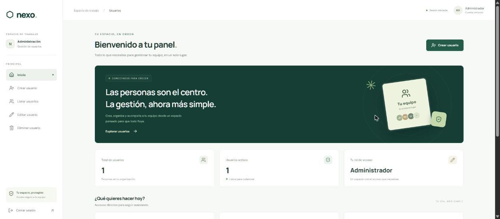 | 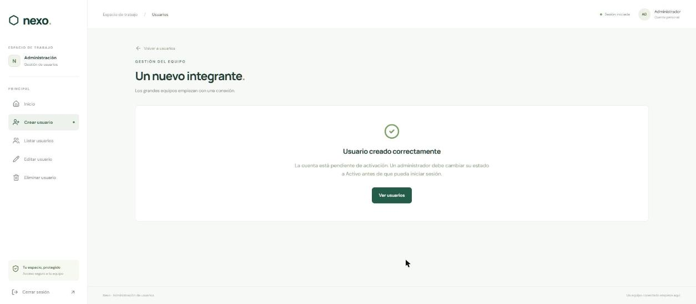 | 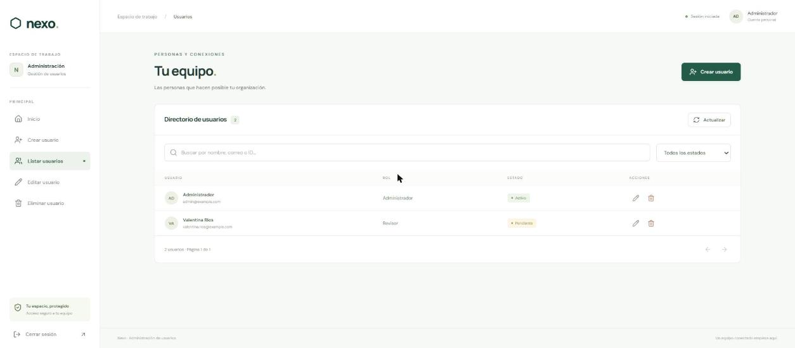 |

| Edición | Borrado |
| --- | --- |
| 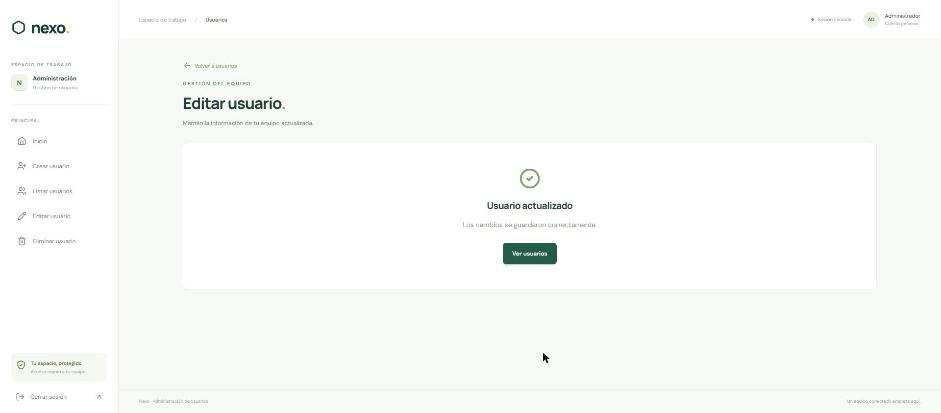 | 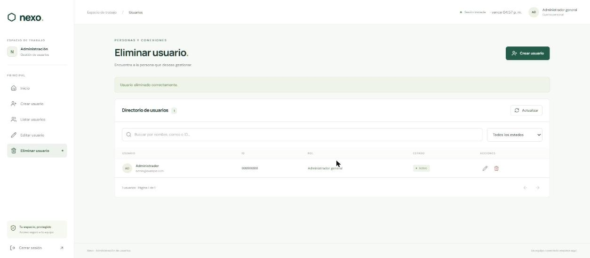 |

La captura del borrado se tomó en la rama `ejercicios`, por eso tiene la columna de ID.

## Ejercicios de la guía 13

Hice siete de los ocho ejercicios en la rama `ejercicios`, cada uno en su propio commit.

| Ejercicio | Qué cambié | Cómo supe que funcionó | Estado |
| --- | --- | --- | --- |
| Etiqueta de rol | `roleLabel` | Dice "Administrador general"; a la API sigue yendo `ADMIN` | Hecho |
| Dos usuarios en la bienvenida | `slice(0, 2)` | Dos filas, total 7 | Hecho |
| Páginas de cinco | `pageSize = 5` | 7 usuarios, 2 páginas | Hecho |
| Columna de ID | Plantilla y un estilo | La petición no cambia | Hecho |
| Hora de vencimiento | `App.vue` | "vence 05:17 p. m." en la cabecera | Hecho |
| Errores por campo | Dominio, servicio, `HttpClient` y formularios | Tres errores a la vez sin llamar a la API; 4 pruebas | Hecho |
| Sesión reactiva | `session-state.ts` | Otra pestaña cambia de usuario y esta se actualiza sola; 1 prueba | Hecho |
| Paginación de servidor | Nada | Depende del backend | Pendiente |

| Etiqueta, columna ID, 5 por página y vencimiento | Página 2 de 2 |
| --- | --- |
| 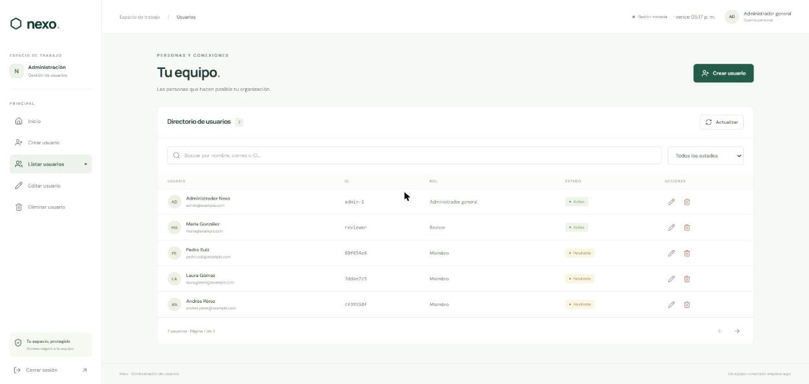 | 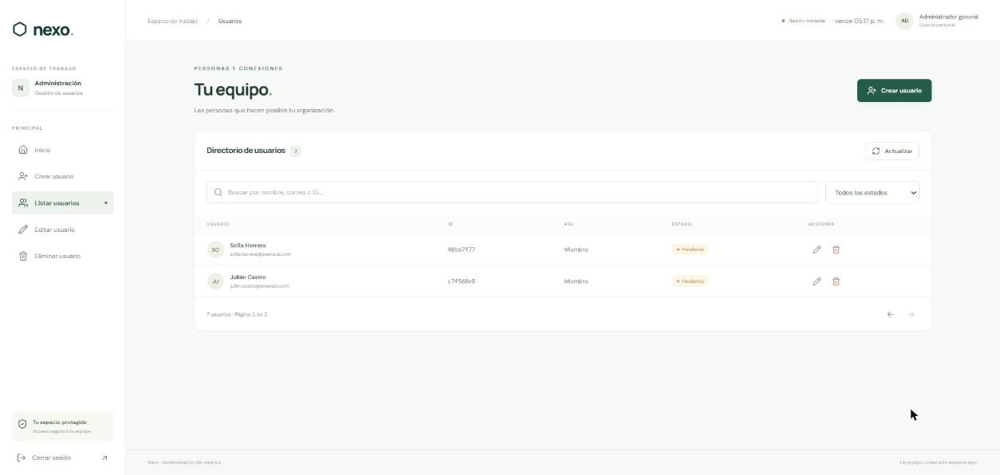 |

**Errores por campo.** Cada capa cambió solo en lo suyo:
- **Dominio:** cada error dice a qué campo pertenece.
- **Aplicación:** junta todos los errores para mostrarlos a la vez.
- **Adaptador:** lee los 400 de user-service, que llegan como `"name: …, password: …, email: …"`. Lo comprobé contra el backend real.
- **Formularios:** ponen cada mensaje debajo de su input, con `aria-invalid`.

En Chrome probé un nombre `"  Al  "`, que pasa el `minlength` por los espacios, el correo `ana@correo`, que el navegador acepta, y una contraseña de 8 espacios. Salieron los tres errores y no se hizo ninguna petición.

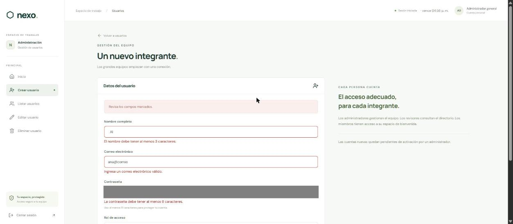

**Sesión reactiva.** Antes la cabecera solo se actualizaba al cambiar de ruta, y las vistas leían el rol una sola vez. Ahora la sesión vive en un `shallowRef` que se entrega con `provide`. Se actualiza al entrar, al salir, con el evento `storage` y cuando la sesión vence. Lo probé con dos pestañas: con el admin abierto en una, entré como revisora en la otra. La primera cambió a "Revisor" y quitó los botones de borrar sin navegar.

| Pestaña A antes | Pestaña A después |
| --- | --- |
| 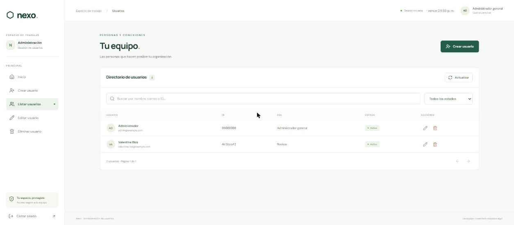 |  |

## Problemas que aparecieron

Ninguno quedó abierto.

| Problema | Causa | Cómo se resolvió |
| --- | --- | --- |
| `npm install -D` falló con `reading 'edgesOut'` | Un error de npm 10.5.1 con Vitest 5 | Instalar con `npx npm@11`, sin tocar el npm del equipo |
| Aviso de npm 11 sobre el script de esbuild | npm 11 no corre scripts sin aprobar | `esbuild --version` respondía y el build funcionó |
| Las pruebas de navegador no arrancaban: puerto 5173 ocupado | Seguía abierto el Vite manual | Cerrarlo y repetir |
| Tildes dañadas al crear usuarios con `curl` | La consola de Windows no envió UTF-8 | Crear los datos con `fetch` desde Node |
| user-service no compila con Java 21 | El `pom.xml` exige JDK 17 | Compilar dentro de Docker con la imagen de Java 17 |
| Sin RabbitMQ, crear o editar daría 503 | El backend publica cada evento y espera confirmación | Agregar RabbitMQ, el exchange `domain.events` y una cola |
| Los mensajes por campo tapaban el borde del input | Un margen negativo en el estilo | Margen superior de 6 px |

## Lo que quedó fuera

- [ ] **Paginación de servidor:** user-service devuelve la lista completa y no acepta `page` ni `size`. Primero hay que cambiar el backend; después cambiarían el puerto, el adaptador, la consulta y `UsersView`.
- [ ] **Cuenta del despliegue en Render:** no tengo una cuenta activa ahí. La API de Render respondió 401 a un login falso, así que está en línea. La prueba real la hice con el mismo backend corriendo en mi equipo.

## Cómo correrlo

```bash
npm ci
npm test
npm run build
npx playwright install chromium
npm run test:e2e
```

Las pruebas de navegador necesitan Postman CLI y los puertos 5173 y 4010 libres. Los ejercicios se ven con `git switch ejercicios`.
